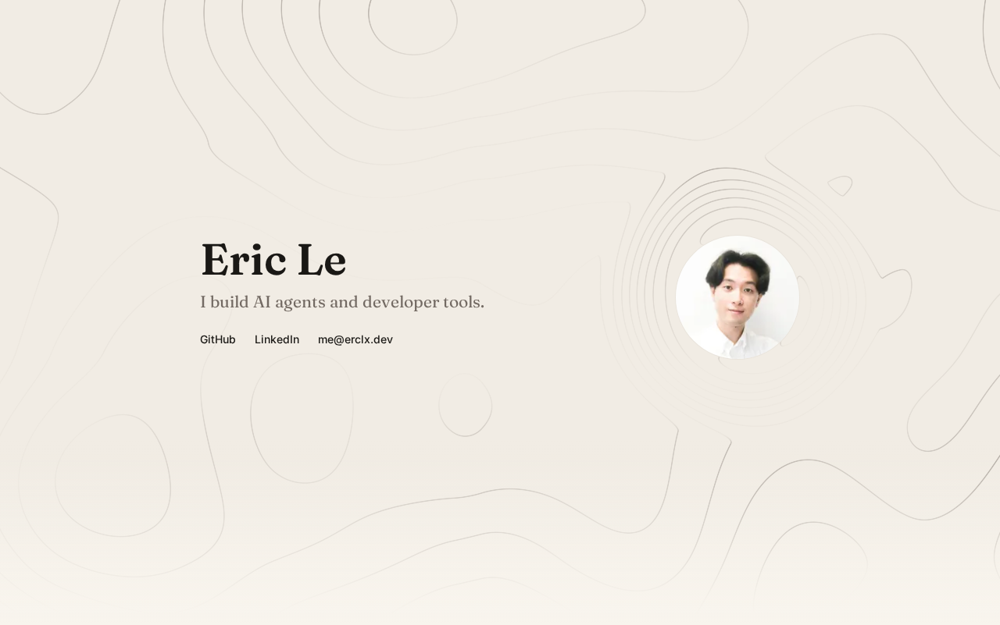

  <picture>
    <source media="(prefers-color-scheme: dark)" srcset="public/avatar/dark.png">
    
  </picture>

<h1 align="center">erclx.dev</h1>

<a href="https://erclx.dev"><b>erclx.dev</b></a>

<picture>
  <source media="(prefers-color-scheme: dark)" srcset=".github/evidence/readme/dark.png">
  
</picture>

## About

I'm Eric, a software developer in Gothenburg. I studied engineering physics at Chalmers and built my first agent during my master's thesis at Volvo. These days I build open-source tools for coding with AI agents, because an agent does its best work when the plan, the rules and the review around it are set up well, and that setup is the part I enjoy.

Outside of that I play tennis and travel whenever I can.

## Built with

Astro, Tailwind, and shadcn/ui, deployed to Cloudflare Pages.
